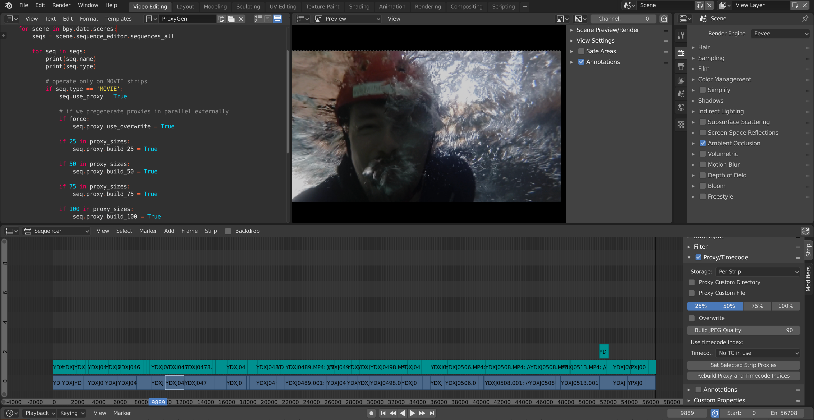
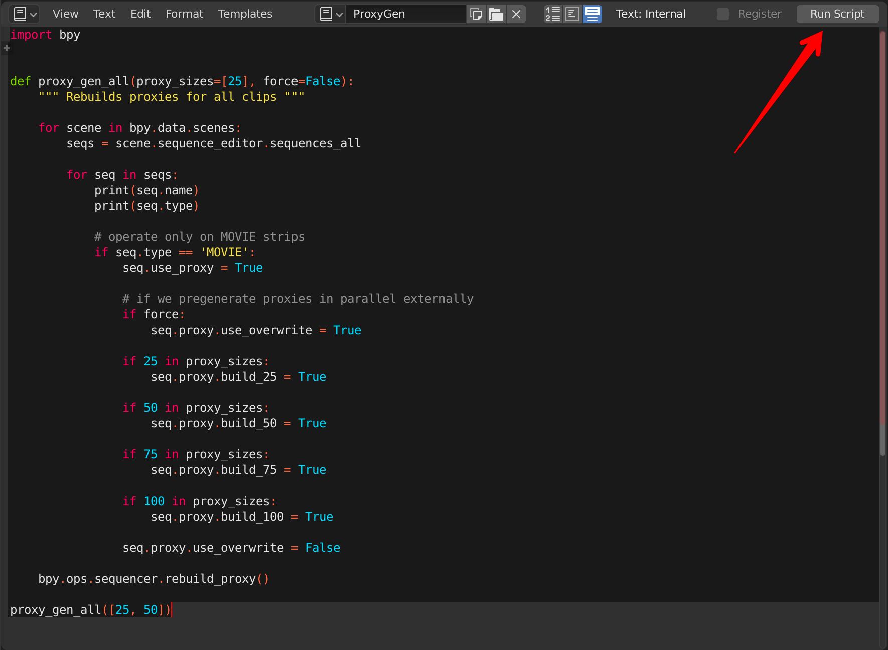

+++
title = "Blender: vse proxy generator"
date = 2018-12-11T22:45:44Z
updated = 2022-04-15T12:14:57Z
aliases = ["/BJbmAnTJ4/"]

[taxonomies]
tags = ["python"]

[extra]
lang = "en"
teletype = "https://blog.antono.info/BJbmAnTJ4"
+++


If You use [blender](https://www.blender.org/) as video editor you probably doing a lot of manual work to setup and rebuild strip proxies (Proxy/timecode) in Sequencer. Been there, tired to do that!

In order to build proxy **for all you strips** just paste this code in bledner text editor and press 'run script':

```python
import bpy

def proxy_gen_all(proxy_sizes=[25], force=False):
    """ Rebuilds proxies for all strips"""

    for scene in bpy.data.scenes:
        seqs = scene.sequence_editor.sequences_all

        for seq in seqs:
            # operate only on MOVIE strips
            if seq.type == 'MOVIE':
                seq.use_proxy = True

                # if we pregenerate proxies in parallel externally
                if force:
                    seq.proxy.use_overwrite = True

                if 25 in proxy_sizes:
                    seq.proxy.build_25 = True

                if 50 in proxy_sizes:
                    seq.proxy.build_50 = True

                if 75 in proxy_sizes:
                    seq.proxy.build_75 = True

                if 100 in proxy_sizes:
                    seq.proxy.build_100 = True

                seq.proxy.use_overwrite = False

    bpy.ops.sequencer.rebuild_proxy()

proxy_gen_all([25, 50])
```



The script will build 25% and 50% proxies for all strips. It will not rebuild proxies if you run it again. Proxy building is time consuming task and unfortunately it blocks blender UI. So if you want to force rebuild the proxies you can just replace last line with this:

```python
proxy_gen_all([25, 50], True)
```

Second argument forces rebuild of all proxies.

Have fun!
