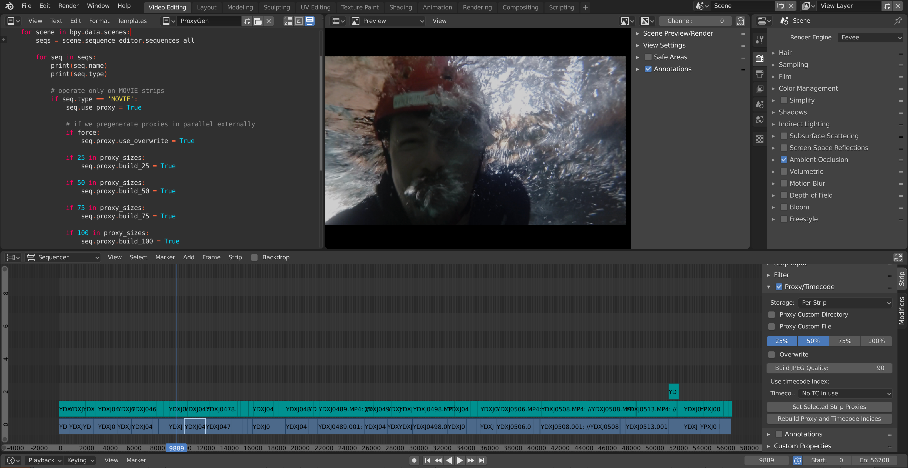
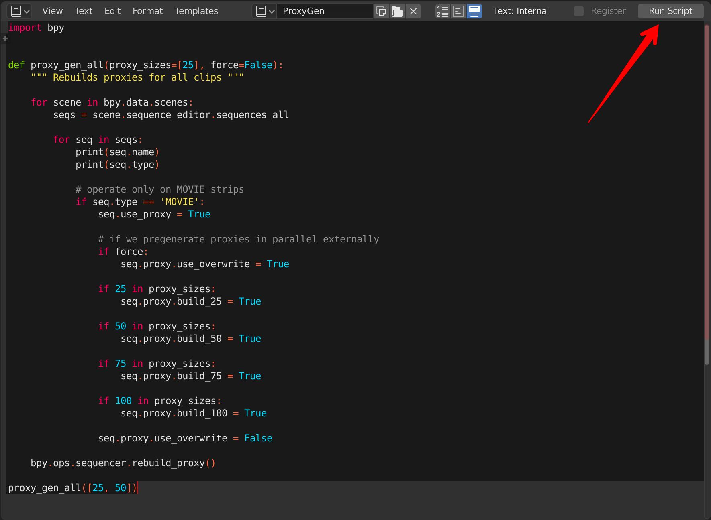

+++
title = "Blender: generilo de prokuraĵoj por VSE"
date = 2018-12-11T22:45:44Z
updated = 2022-04-15T12:14:57Z

[taxonomies]
tags = ["python"]

[extra]
lang = "eo"
teletype = "https://blog.antono.info/BJbmAnTJ4"
+++


Se vi uzas [Blender](https://www.blender.org/) kiel videoredaktilon, vi verŝajne faras multe da mana laboro por agordi kaj rekrei la prokuraĵojn (proxy) de la strioj (Proxy/timecode) en la Sekvencilo (Sequencer). Mi mem trapasis tion, kaj ĝi tedis min!

Por krei prokuraĵojn **por ĉiuj viaj strioj**, simple enmetu ĉi tiun kodon en la tekstoredaktilon de Blender kaj premu „Run Script“:

```python
import bpy

def proxy_gen_all(proxy_sizes=[25], force=False):
    """ Rebuilds proxies for all strips"""

    for scene in bpy.data.scenes:
        seqs = scene.sequence_editor.sequences_all

        for seq in seqs:
            # operate only on MOVIE strips
            if seq.type == 'MOVIE':
                seq.use_proxy = True

                # if we pregenerate proxies in parallel externally
                if force:
                    seq.proxy.use_overwrite = True

                if 25 in proxy_sizes:
                    seq.proxy.build_25 = True

                if 50 in proxy_sizes:
                    seq.proxy.build_50 = True

                if 75 in proxy_sizes:
                    seq.proxy.build_75 = True

                if 100 in proxy_sizes:
                    seq.proxy.build_100 = True

                seq.proxy.use_overwrite = False

    bpy.ops.sequencer.rebuild_proxy()

proxy_gen_all([25, 50])
```



La skripto kreos prokuraĵojn je 25% kaj 50% por ĉiuj strioj. Se vi relanĉos ĝin, ĝi ne rekreos la jam ekzistantajn prokuraĵojn. Kreado de prokuraĵoj daŭras longe kaj bedaŭrinde blokas la interfacon de Blender. Do se vi volas devige rekrei la prokuraĵojn, simple anstataŭigu la lastan linion per jena:

```python
proxy_gen_all([25, 50], True)
```

La dua argumento devigas rekreon de ĉiuj prokuraĵoj.

Ĝuu la muntadon!
