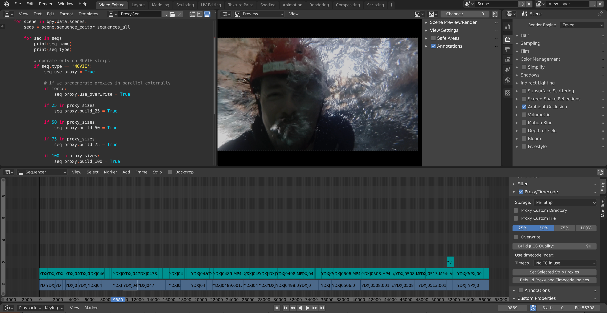
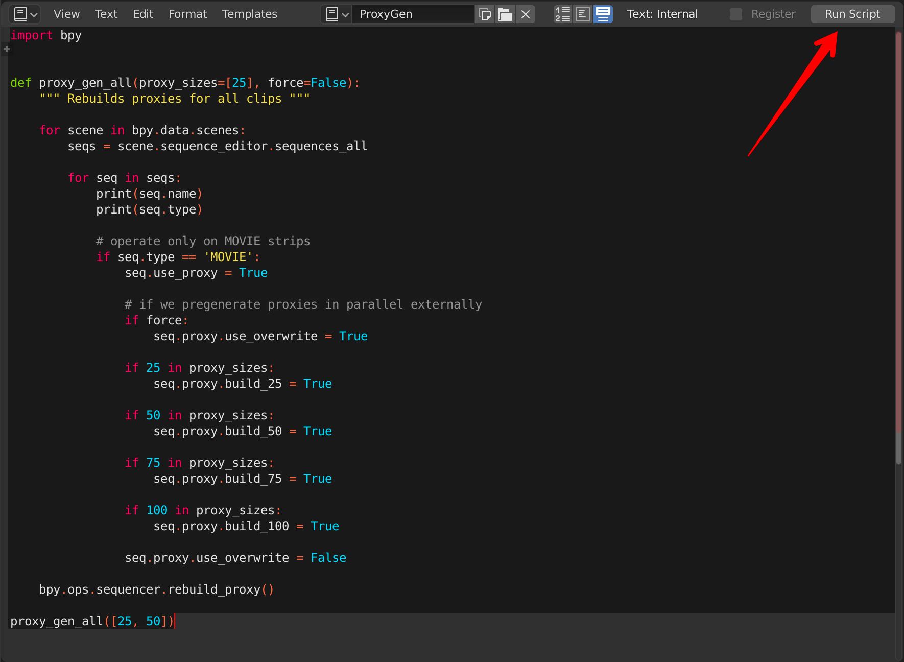

+++
title = "Blender: генератор прокси для VSE"
date = 2018-12-11T22:45:44Z
updated = 2022-04-15T12:14:57Z

[taxonomies]
tags = ["python"]

[extra]
lang = "ru"
teletype = "https://blog.antono.info/BJbmAnTJ4"
+++


Если вы монтируете видео в [Blender](https://www.blender.org/), то наверняка немало возитесь руками, настраивая и пересобирая прокси для клипов (Proxy/timecode) в видеоредакторе (VSE). Плавали — знаем. Надоело!

Чтобы собрать прокси **для всех клипов** разом, просто вставьте этот код в текстовый редактор Blender и нажмите «Run Script»:

```python
import bpy

def proxy_gen_all(proxy_sizes=[25], force=False):
    """ Rebuilds proxies for all strips"""
    
    for scene in bpy.data.scenes:
        seqs = scene.sequence_editor.sequences_all

        for seq in seqs:
            # operate only on MOVIE strips
            if seq.type == 'MOVIE':
                seq.use_proxy = True
            
                # if we pregenerate proxies in parallel externally
                if force:
                    seq.proxy.use_overwrite = True
                
                if 25 in proxy_sizes:
                    seq.proxy.build_25 = True

                if 50 in proxy_sizes:
                    seq.proxy.build_50 = True
                    
                if 75 in proxy_sizes:
                    seq.proxy.build_75 = True

                if 100 in proxy_sizes:
                    seq.proxy.build_100 = True
                
                seq.proxy.use_overwrite = False
    
    bpy.ops.sequencer.rebuild_proxy()
    
proxy_gen_all([25, 50])
```



Скрипт соберёт прокси на 25% и 50% для всех клипов. При повторном запуске уже готовые прокси он пересобирать не станет. Сборка прокси — дело небыстрое, и, к сожалению, интерфейс Blender на это время блокируется. Так что если нужно принудительно пересобрать прокси, просто замените последнюю строку на эту:

```python
proxy_gen_all([25, 50], True)
```

Второй аргумент включает принудительную пересборку всех прокси.

Приятного монтажа!
