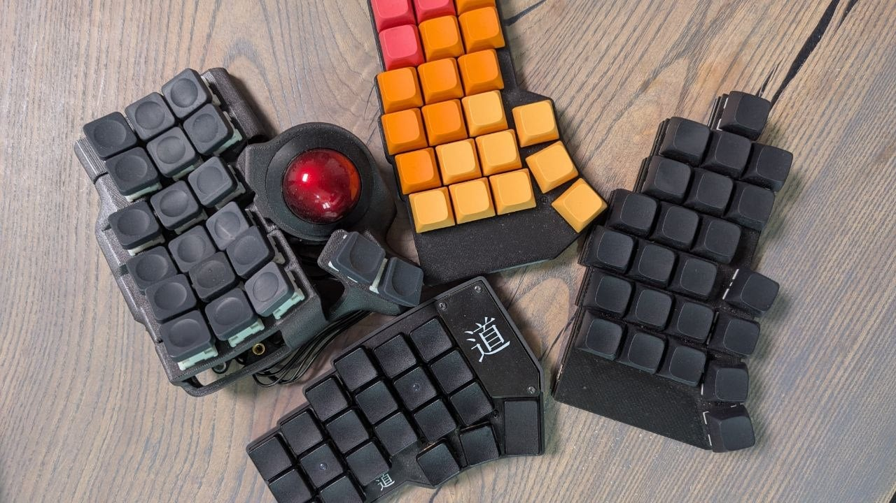
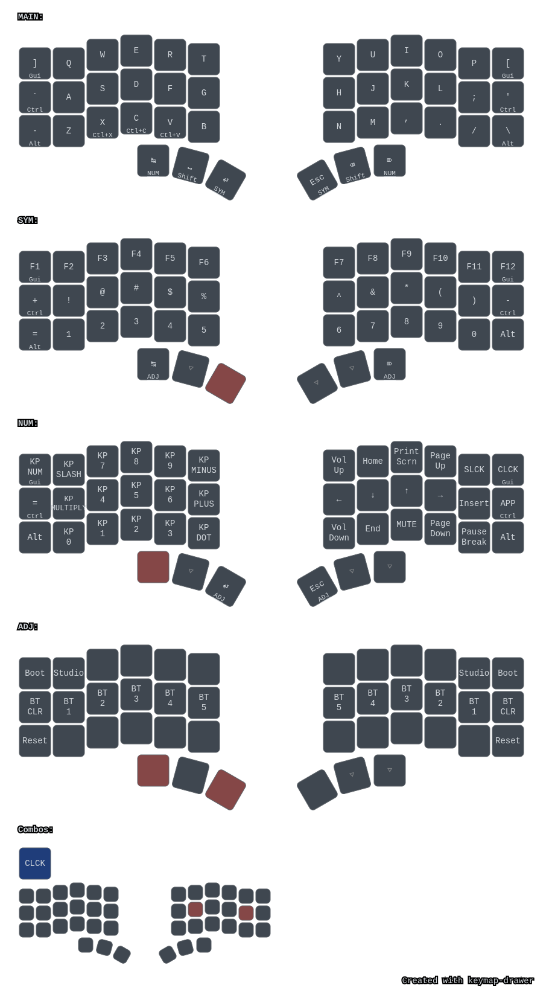

+++
title = "One flake to build them all: managing 5 split keyboards with Nix"
date = 2026-06-25T13:26:52Z
updated = 2026-06-25T13:34:21Z
aliases = ["/keebs-nix/"]

[taxonomies]
tags = ["keebs"]

[extra]
lang = "en"
teletype = "https://blog.antono.info/keebs-nix"
+++
## My story with mechanical keyboards

It started in December 2022. I bought a Dao — a 42-key column-staggered split running [ZMK](https://zmk.dev) — and that was it. I was hooked!

There's something about a split keyboard that rewires how you think about typing. Your hands stop reaching. Layers replace the number row, the symbol row, the navigation cluster. The keymap becomes a personal artifact you tune for months. And once you've tuned one, you want another board to tune.

Three and a half years later I own **five**:

- Ergonaut One — column-stagger split (Seeeduino XIAO BLE + shield)
- HolySwitch TK44 — unibody monosplit (custom board)
- Mriya46 — column-stagger split (two custom nRF52840 boards)
- Dao — the one that started it, 42-key split (+ ZMK Studio)
- Charybdis Mini — 34-key split with a trackball Five keyboards is wonderful.

Five keyboards is also a configuration management problem.



Every ZMK keyboard wants its own `zmk-config` repo. The community workflow is well-paved and, honestly, friendly to beginners:

1. Fork someone's `*-zmk-config` repo on GitHub.
2. Edit the `.keymap` file.
3. Push.
4. GitHub Actions reads `build.yaml`, spins up a runner, clones Zephyr + ZMK, compiles, and uploads `.uf2` artifacts.
5. Download the zip, unzip, flash each half.

This workflow is beginner friendly but have some problems:

- Every tweak — even fixing one keycode — means commit → push → wait for the runner to cold-clone Zephyr → download zip → unzip → flash. Minutes of round-trip for a one-character edit.
- Five repos, five forks, five histories. Each keyboard a separate fork, each drifting from its upstream, each with its own quirks. Aligning all five keymaps to the same layout meant five PRs in five places.
- Not reproducible. "It built last month" is not the same as "it builds the same bytes today." Upstream ZMK `main` moves, runners change, and one day your config simply doesn't compile anymore. That last point bit me. ZMK `main` migrated to Zephyr's \*\*Hardware Model v2\*\*, which renamed the very boards my configs depend on (seeeduino_xiao_ble → xiao_ble, nice_nano_v2 → nice_nano). Configs that built fine suddenly didn't. The CI-fork workflow has no answer for "pin the whole world."

## keebs-nix: one flake to build them all

Nix does have an answer for "pin the whole world." So I built [keebs-nix](https://github.com/antono/keebs-nix) — a single, self-contained flake that builds firmware for all five keyboards, on top of [zmk-nix](https://github.com/lilyinstarlight/zmk-nix).

Each keyboard's complete ZMK config — `west.yml`, `boards/`, keymaps, `.conf` — is **vendored** verbatim into this repo. No forks, no external config repos, no submodules. The flake has exactly two inputs: `nixpkgs` and `zmk-nix`.

## What the flake does

Builds everything with one command.

```sh
nix build               # all firmware → ./result (combined .uf2 dir)
nix build .#dao         # or just one
```

The output is a single directory with stable, human-readable filenames — no hunting through `zmk_left.uf2` artifacts wondering which board they came from:

```text
ergonaut_one_left.uf2   ergonaut_one_right.uf2   ergonaut_one_settings_reset.uf2
tk44.uf2
mriya46_left.uf2        mriya46_right.uf2        mriya46_settings_reset.uf2
dao_left.uf2            dao_right.uf2            dao_studio_left.uf2  ...
charybdis_mini_left.uf2 charybdis_mini_right.uf2 charybdis_mini_settings_reset.uf2
```

Flashes from the command line.

```sh
nix run .#flash-dao        # prompts for left, then right
nix run .#flash-tk44
nix run .#flash-dao-reset  # settings reset, built on nice_nano_v2
```

Renders keymap diagrams. Every keyboard's README embeds a layout SVG generated by [keymap-drawer ](https://github.com/caksoylar/keymap-drawer)straight from the vendored keymap:

```sh
nix run .#draw-keymaps
```



So the docs can't drift from the firmware — they're parsed from the same `.keymap` file the build uses.

## Why Nix is the right tool for this

**Reproducibility, for real.** The vendored west.yml files pin ZMK to v0.3-branch plus Zephyr 3.5 — the known-good, pre-HWMv2 revision. That sidesteps the board-rename breakage entirely. The build that works today produces identical bytes next year. Nix doesn't try to be reproducible; it's the whole premise.

**One shared dependency fetch.** All five configs ship a byte-identical west.yml, so instead of each keyboard cold-cloning multi-gigabyte Zephyr and ZMK trees, a single fixed-output derivation fetches the West deps once and every keyboard reuses it. One hash in flake.nix covers the whole fleet. The fetch even does a shallow narrow depth-1 update so it pulls minutes of data instead of hours on a slow link — and survives GitHub's flaky HTTP/2 stream resets on the big clone.

**Fast local change/flash cycle.** Edit a keymap, run nix build, run nix flash. No push, no runner, no zip. The deps are cached, so rebuilds are quick. This is the single biggest day-to-day win over the CI-fork loop.

**Adding a keyboard is one line.** New boards drop into the keyboards directory and a single entry in the firmwareOutputs map. The bundle-copy logic globs each build's actual uf2 outputs and renames them generically, so splits and single-firmware boards both just work — no hardcoded filenames.

**Self-contained.** Because every config is vendored rather than referenced, there's nothing to go stale out from under me. The Dao even vendors its board definition from the ergonautkb ZMK module rather than pulling it via west.yml, so it's as self-contained as the rest.
