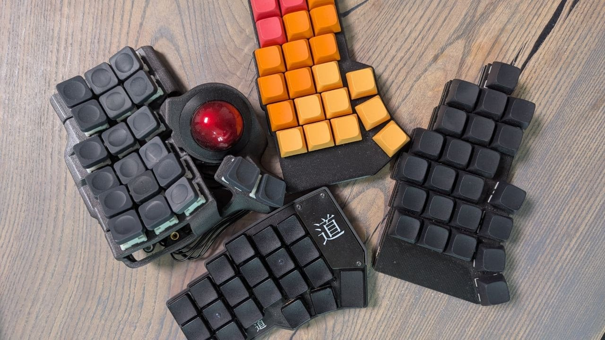
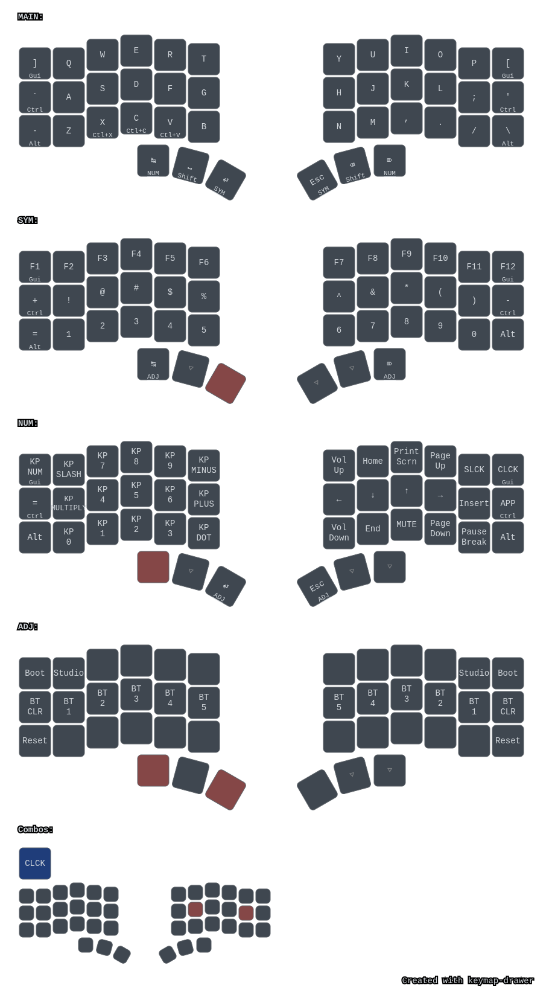

+++
title = "Unu floko por konstrui ilin ĉiujn: kiel mi mastrumas 5 dividitajn klavarojn per Nix"
date = 2026-06-25T13:26:52Z
updated = 2026-06-25T13:34:21Z

[taxonomies]
tags = ["keebs"]

[extra]
lang = "eo"
teletype = "https://blog.antono.info/keebs-nix"
+++
## Mia historio kun mekanikaj klavaroj

Ĉio komenciĝis en decembro 2022. Mi aĉetis Dao-n — 42-klavan dividitan klavaron (*split*) kun kolona deŝovo, kiu funkcias per [ZMK](https://zmk.dev) — kaj jen. Mi estis kaptita!

Estas io en dividita klavaro, kio rekabligas vian pensadon pri tajpado. Viaj manoj ĉesas etendiĝi. Tavoloj anstataŭas la ciferan vicon, la simbolan vicon, la navigan blokon. La klavmapo fariĝas persona artefakto, kiun vi agordas dum monatoj. Kaj kiam vi jam agordis unu klavaron, vi volas alian por agordi.

Tri jarojn kaj duonon poste mi posedas **kvin**:

- Ergonaut One — dividita, kun kolona deŝovo (Seeeduino XIAO BLE + ŝildo)
- HolySwitch TK44 — unukorpa klavaro kun dividita aranĝo (*monosplit*; propra plato)
- Mriya46 — dividita, kun kolona deŝovo (du propraj platoj kun nRF52840)
- Dao — tiu, per kiu ĉio komenciĝis, 42-klava dividita (+ ZMK Studio)
- Charybdis Mini — 34-klava dividita kun spurbulo

Kvin klavaroj — tio estas mirinda.

Sed kvin klavaroj estas ankaŭ problemo de agordo-mastrumado.



Ĉiu ZMK-klavaro volas propran deponejon `zmk-config`. La komunuma laborfluo estas bone tretita kaj, sincere dirite, afabla al komencantoj:

1. Forku ies deponejon `*-zmk-config` ĉe GitHub.
2. Redaktu la dosieron `.keymap`.
3. Puŝu.
4. GitHub Actions legas `build.yaml`, lanĉas rulilon (*runner*), klonas Zephyr + ZMK, kompilas kaj alŝutas la artefaktojn `.uf2`.
5. Elŝutu la zip-arkivon, malpaku ĝin, skribu la mikroprogramon en ĉiun duonon.

Tiu laborfluo taŭgas por komencantoj, sed ĝi havas kelkajn problemojn:

- Ĉiu ŝanĝeto — eĉ korekto de unu klavkodo — signifas: enmeto (*commit*) → puŝo → atendi, ĝis la rulilo klonos Zephyr de nulo → elŝuti la zip-arkivon → malpaki → skribi la mikroprogramon. Minutoj por unu rondiro pro unusigna ŝanĝo.
- Kvin deponejoj, kvin forkoj, kvin historioj. Ĉiu klavaro estas aparta forko, ĉiu iom post iom forfluas de sia fonto (*upstream*), ĉiu kun siaj strangaĵoj. Por unuecigi ĉiujn kvin klavmapojn al sama aranĝo necesis kvin tirpetoj (*PR*) en kvin lokoj.
- Ne reprodukteble. „Ĝi konstruiĝis pasintmonate“ ne samas al „hodiaŭ ĝi konstruas la samajn bajtojn“. La branĉo `main` de ZMK moviĝas antaŭen, ruliloj ŝanĝiĝas, kaj iun belan tagon via agordo simple ne plu kompiliĝas. Ĝuste tiu lasta punkto mordis min. ZMK `main` migris al \*\*Hardware Model v2\*\* de Zephyr, kiu renomis ĝuste tiujn platojn, de kiuj dependas miaj agordoj (seeeduino_xiao_ble → xiao_ble, nice_nano_v2 → nice_nano). Agordoj, kiuj bone konstruiĝis, subite ne plu. La laborfluo „CI + forko“ ne havas respondon al „fiksu la tutan mondon“.

## keebs-nix: unu floko por konstrui ilin ĉiujn

Nix ja havas respondon al „fiksu la tutan mondon“. Do mi kreis [keebs-nix](https://github.com/antono/keebs-nix) — unu memstaran flokon (*flake*), kiu konstruas la mikroprogramojn por ĉiuj kvin klavaroj, surbaze de [zmk-nix](https://github.com/lilyinstarlight/zmk-nix).

La kompleta ZMK-agordo de ĉiu klavaro — `west.yml`, `boards/`, klavmapoj, `.conf` — estas laŭvorte **enkopiita** (*vendored*) en ĉi tiun deponejon. Neniuj forkoj, neniuj eksteraj agordaj deponejoj, neniuj submoduloj. La floko havas ĝuste du enigojn: `nixpkgs` kaj `zmk-nix`.

## Kion la floko faras

Ĝi konstruas ĉion per unu komando.

```sh
nix build               # all firmware → ./result (combined .uf2 dir)
nix build .#dao         # or just one
```

La rezulto estas unu dosierujo kun stabilaj, homlegeblaj dosiernomoj — ne plu necesas fosi inter artefaktoj `zmk_left.uf2`, scivolante, de kiu klavaro ili venis:

```text
ergonaut_one_left.uf2   ergonaut_one_right.uf2   ergonaut_one_settings_reset.uf2
tk44.uf2
mriya46_left.uf2        mriya46_right.uf2        mriya46_settings_reset.uf2
dao_left.uf2            dao_right.uf2            dao_studio_left.uf2  ...
charybdis_mini_left.uf2 charybdis_mini_right.uf2 charybdis_mini_settings_reset.uf2
```

Ĝi skribas la mikroprogramon rekte el la komandlinio.

```sh
nix run .#flash-dao        # prompts for left, then right
nix run .#flash-tk44
nix run .#flash-dao-reset  # settings reset, built on nice_nano_v2
```

Ĝi desegnas diagramojn de la klavmapoj. La README de ĉiu klavaro enhavas SVG-bildon de la aranĝo, generitan de [keymap-drawer](https://github.com/caksoylar/keymap-drawer) rekte el la enkopiita klavmapo:

```sh
nix run .#draw-keymaps
```



Tiel la dokumentaro ne povas forflui de la mikroprogramo — ĝi estas analizata el la sama dosiero `.keymap`, kiun uzas la konstruado.

## Kial Nix estas la ĝusta ilo por tio

**Reprodukteblo — vera.** La enkopiitaj dosieroj west.yml fiksas ZMK je v0.3-branch plus Zephyr 3.5 — la konate bona revizio de antaŭ HWMv2. Tio tute evitas la rompiĝon pro la renomitaj platoj. La konstruo, kiu funkcias hodiaŭ, donos identajn bajtojn ankaŭ venontjare. Nix ne *klopodas* esti reproduktebla; tio estas ĝia tuta fundamento.

**Unu komuna elŝuto de dependaĵoj.** Ĉiuj kvin agordoj enhavas bajte identan west.yml, do anstataŭ ke ĉiu klavaro de nulo klonu plurgigabajtajn arbojn de Zephyr kaj ZMK, unu derivaĵo kun fiksita eligo (*fixed-output derivation*) elŝutas la West-dependaĵojn unufoje, kaj ĉiu klavaro reuzas ilin. Unu haketo en flake.nix kovras la tutan aron. La elŝuto eĉ faras malprofundan, mallarĝan ĝisdatigon kun profundo 1, do per malrapida konekto ĝi tiras datumojn dum minutoj anstataŭ horoj — kaj eltenas la kapricajn rekomencigojn de HTTP/2-fluoj ĉe GitHub dum la granda klonado.

**Rapida loka ciklo „ŝanĝi — skribi“.** Redaktu klavmapon, rulu nix build, rulu nix flash. Neniu puŝo, neniu rulilo, neniu zip-arkivo. La dependaĵoj estas en la kaŝmemoro, do rekonstruoj estas rapidaj. En la ĉiutaga laboro tio estas la plej granda gajno kompare kun la ciklo „CI + forko“.

**Aldoni klavaron — unu linio.** Novaj platoj iras en la dosierujon keyboards, plus unu ero en la mapo firmwareOutputs. La kunpaka logiko trovas per ĵokeraj ŝablonoj (*glob*) la realajn uf2-eligaĵojn de ĉiu konstruo kaj renomas ilin laŭ ĝenerala skemo, do kaj dividitaj klavaroj kaj platoj kun unu sola mikroprogramo simple funkcias — neniuj dosiernomoj fiksitaj en la kodo.

**Memstareco.** Ĉar ĉiu agordo estas enkopiita, ne nur referencita, nenio povas malfreŝiĝi sub miaj piedoj. La Dao eĉ enkopias la difinon de sia plato el la ZMK-modulo ergonautkb anstataŭ tiri ĝin per west.yml, do ĝi estas same memstara kiel la ceteraj.
