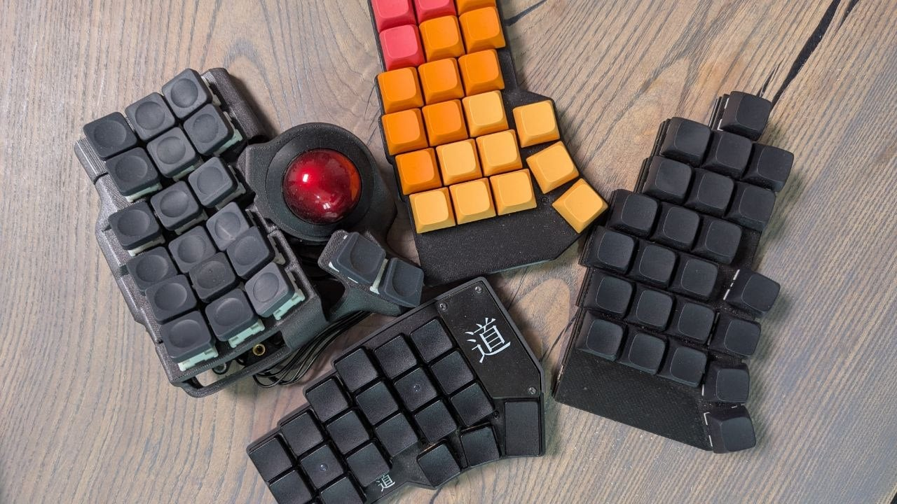
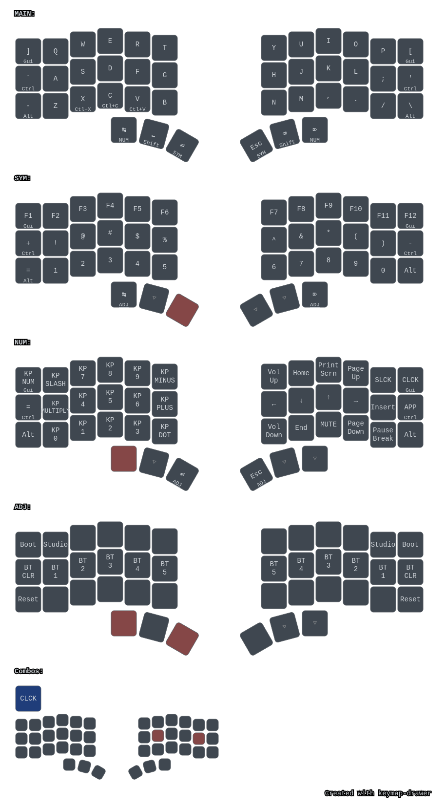

+++
title = "Один флейк, чтоб собрать их все: как я управляю пятью сплитами через Nix"
date = 2026-06-25T13:26:52Z
updated = 2026-06-25T13:34:21Z

[taxonomies]
tags = ["keebs"]

[extra]
lang = "ru"
teletype = "https://blog.antono.info/keebs-nix"
+++
## Моя история с механическими клавиатурами

Всё началось в декабре 2022-го. Я купил Dao — 42-клавишный сплит с колоночным стаггером на [ZMK](https://zmk.dev) — и всё, пропал. Подсел!

Есть в сплитах что-то такое, что перепрошивает само представление о печати. Руки перестают тянуться к дальним клавишам. Цифровой ряд, ряд символов, блок навигации — всё это заменяют слои. Кеймап превращается в личный артефакт, который ты месяцами подкручиваешь под себя. А как только одну клаву довёл до ума — хочется следующую, чтобы допиливать уже её.

Три с половиной года спустя у меня их **пять**:

- Ergonaut One — сплит с колоночным стаггером (Seeeduino XIAO BLE + шилд)
- HolySwitch TK44 — моносплит в цельном корпусе (кастомная плата)
- Mriya46 — сплит с колоночным стаггером (две кастомные платы на nRF52840)
- Dao — та самая, с которой всё началось, 42-клавишный сплит (+ ZMK Studio)
- Charybdis Mini — 34-клавишный сплит с трекболом

Пять клавиатур — это прекрасно.

Но пять клавиатур — это ещё и задачка по управлению конфигурацией.



Каждой клавиатуре на ZMK нужен свой репозиторий `zmk-config`. Принятый в сообществе путь хорошо протоптан и, честно говоря, вполне дружелюбен к новичкам:

1. Форкаешь чей-нибудь репозиторий `*-zmk-config` на GitHub.
2. Правишь файл `.keymap`.
3. Пушишь.
4. GitHub Actions читает `build.yaml`, поднимает раннер, клонирует Zephyr + ZMK, компилирует и выкладывает артефакты `.uf2`.
5. Скачиваешь zip, распаковываешь, прошиваешь каждую половинку.

Для новичка это удобно, но есть нюансы:

- Любая правка — даже исправление одного кейкода — это коммит → пуш → ждёшь, пока раннер с нуля склонирует Zephyr → качаешь zip → распаковываешь → прошиваешь. Минуты на круг ради правки в один символ.
- Пять репозиториев, пять форков, пять историй. Каждая клава — отдельный форк, каждый потихоньку уползает от своего апстрима, у каждого свои причуды. Чтобы привести все пять кеймапов к одной раскладке, приходилось делать пять PR в пяти местах.
- Никакой воспроизводимости. «В прошлом месяце собиралось» — совсем не то же самое, что «сегодня собирается в те же самые байты». `main` в апстриме ZMK уезжает вперёд, раннеры меняются, и в один прекрасный день твой конфиг просто перестаёт компилироваться. На этом последнем пункте я и погорел. ZMK `main` переехал на \*\*Hardware Model v2\*\* из Zephyr, а там переименовали те самые платы, от которых зависят мои конфиги (seeeduino_xiao_ble → xiao_ble, nice_nano_v2 → nice_nano). Конфиги, которые прекрасно собирались, внезапно перестали. А на вопрос «как запинить весь мир» у схемы «CI + форк» ответа нет.

## keebs-nix: один флейк, чтоб собрать их все

А вот у Nix ответ на «запинить весь мир» как раз есть. Поэтому я сделал [keebs-nix](https://github.com/antono/keebs-nix) — единый самодостаточный флейк поверх [zmk-nix](https://github.com/lilyinstarlight/zmk-nix), который собирает прошивки для всех пяти клавиатур.

Полный ZMK-конфиг каждой клавиатуры — `west.yml`, `boards/`, кеймапы, `.conf` — **завендорен** в этот репозиторий как есть, один в один. Никаких форков, внешних репозиториев с конфигами и сабмодулей. У флейка ровно два входа: `nixpkgs` и `zmk-nix`.

## Что умеет флейк

Собирает всё одной командой.

```
nix build               # all firmware → ./result (combined .uf2 dir)
nix build .#dao         # or just one
```

На выходе — одна директория со стабильными, человекочитаемыми именами файлов. Больше не надо копаться в артефактах `zmk_left.uf2` и гадать, от какой они клавы:

```
ergonaut_one_left.uf2   ergonaut_one_right.uf2   ergonaut_one_settings_reset.uf2
tk44.uf2
mriya46_left.uf2        mriya46_right.uf2        mriya46_settings_reset.uf2
dao_left.uf2            dao_right.uf2            dao_studio_left.uf2  ...
charybdis_mini_left.uf2 charybdis_mini_right.uf2 charybdis_mini_settings_reset.uf2
```

Прошивает из командной строки.

```
nix run .#flash-dao        # prompts for left, then right
nix run .#flash-tk44
nix run .#flash-dao-reset  # settings reset, built on nice_nano_v2
```

Рисует схемы кеймапов. В README каждой клавиатуры встроена SVG-схема раскладки, которую [keymap-drawer](https://github.com/caksoylar/keymap-drawer) генерирует прямо из завендоренного кеймапа:

```
nix run .#draw-keymaps
```



Так что документация физически не может разойтись с прошивкой — она парсится из того же файла `.keymap`, что и сборка.

## Почему Nix — правильный инструмент для этой задачи

**Воспроизводимость — по-настоящему.** Завендоренные west.yml пинят ZMK на v0.3-branch плюс Zephyr 3.5 — заведомо рабочую ревизию ещё до HWMv2. Это начисто обходит поломку с переименованием плат. Сборка, которая работает сегодня, и через год выдаст байт в байт то же самое. Nix не «старается» быть воспроизводимым — на этом он целиком и построен.

**Одна общая загрузка зависимостей.** Во всех пяти конфигах лежит побайтово одинаковый west.yml, поэтому вместо того чтобы каждая клавиатура с нуля клонировала многогигабайтные деревья Zephyr и ZMK, одна fixed-output-деривация скачивает West-зависимости один раз, а все клавиатуры её переиспользуют. Один хеш в flake.nix покрывает весь парк. Загрузка к тому же делает неглубокий и узкий апдейт с depth 1, так что на медленном канале данные тянутся минуты, а не часы, — и переживает капризные сбросы HTTP/2-стримов GitHub на большом клоне.

**Быстрый локальный цикл «поправил — прошил».** Правишь кеймап, запускаешь nix build, потом nix flash. Ни пуша, ни раннера, ни zip-архивов. Зависимости лежат в кеше, так что пересборка быстрая. В повседневной жизни это самый большой выигрыш по сравнению с круговоротом «CI + форк».

**Новая клавиатура — одна строчка.** Новые платы кладутся в директорию keyboards, плюс одна запись в мапе firmwareOutputs. Логика сборки бандла глобом находит реальные uf2-файлы каждой сборки и переименовывает их по общей схеме, так что и сплиты, и платы с единственной прошивкой просто работают — никаких захардкоженных имён файлов.

**Самодостаточность.** Раз каждый конфиг завендорен, а не подключён по ссылке, ничего не может тихо протухнуть у меня за спиной. Dao даже вендорит определение своей платы из ZMK-модуля ergonautkb, а не тянет его через west.yml, так что он ничуть не менее самодостаточен, чем остальные.
